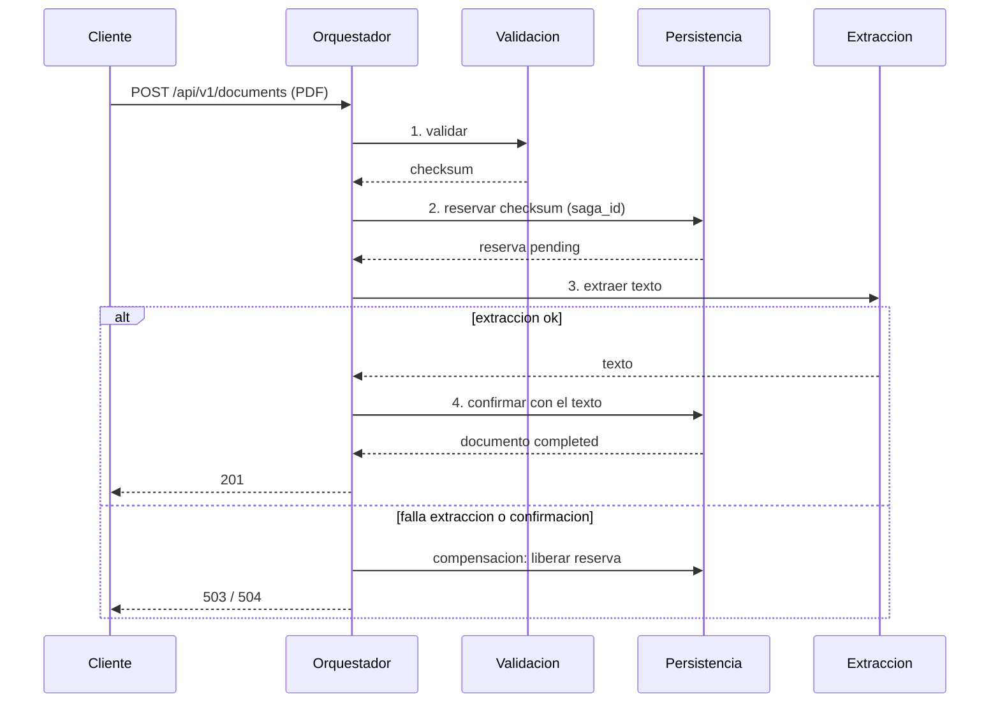

# pdf-extractext-orchestrator

**Orquestador** de PDF-extractext. Expone la API pública (la misma que tenía el monolito en la Etapa 1) y coordina la subida de documentos con el **patrón Saga**.

No tiene base de datos: sus "repositorios" son clientes HTTP hacia los servicios internos.

## API pública

Base: `https://api.pdfextractext.localhost/api/v1/documents`

| Método | Ruta | Descripción | OK |
|---|---|---|---|
| `POST` | `/` | Sube un PDF (`file`, y `custom_name` opcional) | `201` |
| `GET` | `/?skip=0&limit=20` | Lista paginada | `200` |
| `GET` | `/{id}` | Un documento | `200` |
| `PUT` | `/{id}` | Renombra: `{"custom_name": "nuevo.pdf"}` | `200` |
| `DELETE` | `/{id}` | Borra | `200` |
| `GET` | `/{id}/download` | Descarga el texto como `.txt` | `200` |

| Status | Cuándo |
|---|---|
| `400` | No es un PDF válido |
| `404` | El documento no existe |
| `409` | Ya existe un documento con el mismo contenido |
| `413` | Supera el tamaño máximo |
| `422` | Parámetros inválidos |
| `502` | Un servicio interno respondió algo inesperado |
| `503` | Un servicio interno está caído o saturado |
| `504` | Un servicio interno no respondió a tiempo |

`GET /health` informa el estado de los tres servicios internos en `dependencies`.

## Saga de subida



- **Por qué este orden:** la extracción es la parte más cara. Reservar antes permite descartar duplicados (409) sin gastar CPU, y la reserva con índice único resuelve dos subidas simultáneas del mismo archivo.
- **Compensación:** si falla un paso después de la reserva, se libera la reserva. Si la compensación también falla, la reserva vence sola por TTL en Mongo.
- **Trazabilidad:** cada subida tiene un `saga_id` que aparece en todos los logs (`saga=… paso=reserva ok`), así se puede seguir el orden exacto.

## Arquitectura

```
presentation   document_router (api publica) · controller · DTOs · descarga .txt · errores RFC 9457
use_cases      UploadDocumentUseCase (saga) · List · Get · Rename · Delete
business       Saga generica · entidades · excepciones · puertos de los tres servicios
data           ValidationClient · ExtractionClient · DocumentsClient (httpx) · traduccion de errores
infrastructure clientes http con timeouts y reintentos · Consul · tags de Traefik · health · instancia
```

## Resiliencia

- **Timeouts** por servicio (`VALIDATION_TIMEOUT`, `EXTRACTION_TIMEOUT`, `DOCUMENTS_TIMEOUT`).
- **Reintentos de conexión** en el cliente httpx (`HTTP_CONNECT_RETRIES`). Solo se reintentan las conexiones que fallan, nunca un request ya enviado.
- **Traefik** suma balanceo entre réplicas, circuit breaker y reintentos, porque las llamadas internas también pasan por él (`*.internal`).
- **Degradación:** si un servicio interno no responde, `/health` sigue en 200 pero informa `degraded`, y las operaciones que lo necesitan responden 503 con Problem Details.

## Configuración

Ver `.env.example`. Las propias de este servicio:

| Variable | Por defecto | Descripción |
|---|---|---|
| `VALIDATION_URL` | `http://validation.internal:8000` | Servicio de validación |
| `EXTRACTION_URL` | `http://extract.internal:8000` | Servicio de extracción |
| `DOCUMENTS_URL` | `http://documents.internal:8000` | Servicio de persistencia |
| `VALIDATION_TIMEOUT` / `EXTRACTION_TIMEOUT` / `DOCUMENTS_TIMEOUT` | `10` / `60` / `10` | Segundos |
| `HTTP_CONNECT_RETRIES` | `2` | Reintentos de conexión |
| `MAX_PDF_SIZE_MB` | `10` | Tamaño máximo del upload |
| `PUBLIC_HOST` | `api.pdfextractext.localhost` | Host HTTPS |

## Desarrollo

```bash
uv sync
uv run pytest          # los servicios internos se simulan con httpx.MockTransport
```

## Plataforma (igual en los cuatro servicios)

| Pieza | Archivo | Qué hace |
|---|---|---|
| Registro en Consul | `app/infrastructure/consul_registry.py` | Al arrancar registra la instancia con ID único (`<servicio>-<hex>`), su IP, el check HTTP a `/health` y los tags de Traefik. Si Consul no está, reintenta en segundo plano. Al apagarse se da de baja. |
| Tags de Traefik | `app/infrastructure/traefik_tags.py` | Routers interno y público, circuit breaker y reintentos |
| Health | `app/infrastructure/health.py` | Contrato común: `status`, `service`, `version`, `instance_id`, `uptime_seconds`, `memory_mb`, `requests_in_flight`, `dependencies` |
| Errores | `app/presentation/error_handlers.py` | Todo error sale en formato RFC 9457 (`application/problem+json`) |

## Ejecución dentro del sistema completo

Este servicio no se levanta solo en producción: lo levanta `pdf-extractext-deploy` junto con Traefik, Consul y el resto de los servicios.

```bash
cd ../pdf-extractext-deploy
./scripts/up.sh
```

## Imagen Docker

- Multi-stage: `uv` solo está en la etapa de build; la imagen final tiene Python 3.14 slim, el venv y el código.
- Usuario sin privilegios (`appuser`) y zona horaria `America/Argentina/Buenos_Aires`.
- `HEALTHCHECK` contra `/health`.
- Granian toma host, puerto y workers de `GRANIAN_*`, así que el puerto no queda fijo en la imagen.

```bash
docker build -t pdf-extractext/orchestrator:1.0.0 .
```

## Principios aplicados

- **Arquitectura limpia / puertos y adaptadores:** el negocio depende de interfaces y `app/dependencies.py` elige las implementaciones.
- **SOLID, DRY, KISS, YAGNI:** un caso de uso por operación, sin dependencias que no se usan.
- **TDD:** cada cambio arranca con un test que falla.
- **12-Factor:** un repo por servicio (I), dependencias fijadas con `uv.lock` (II), configuración por entorno (III), servicios externos por URL (IV), build y run separados (V), procesos sin estado (VI), port binding (VII), apagado ordenado (IX), logs a stdout (XI).

## Equipo

Fabio, Luciana y Celina — Desarrollo de Software, UTN Facultad Regional San Rafael, 2026.

## Licencia

MIT, ver [LICENSE](LICENSE).
